# wCam - 高位深移动端原始图像开发相机与自定义 ISP 引擎

<div align="center">
  <b>专业级 Android RAW 摄影 ｜ 完全自主可控 16-bit 图像处理流水线</b>
</div>

---

## 📖 项目简介

wCam 是一款专为 Android 平台设计的高级、实验性专业级摄影应用程序。它专注于从相机硬件底层（基于 Camera2 API）获取原始的 RAW Bayer 信号，并建立了一条完全自主可控的 **16-bit 图像信号处理（ISP）流水线**。

本项目坚持**纯粹数学显影**路径，全链路基于物理光学逻辑与经典数字信号处理算法实现，**不包含任何 AI 增强、计算摄影补丁或深度学习降噪**。我们推崇最真实的信号还原：捕获的光子即是全部，没有任何“脑补”修复。这不仅是一个摄影工具，更是对光学本质的敬畏，让用户对画质拥有绝对的控制权。

---

## ✨ 核心功能特色

*   **完全手动控制**：支持手动设置 ISO、快门速度、白平衡、对焦等参数，摆脱系统限制。
*   **精准闪光灯控制（预闪状态机）**：完全模拟专业相机的 AE（自动曝光）预闪机制。拍摄时先触发短促预闪以测算反光强度，曝光收敛后再触发主闪光，确保纯黑环境下的精准曝光。支持常亮（Torch）模式用于辅助对焦。
*   **实时直方图**：采用降采样与多线程技术，后台抽取亮度信息计算 0-255 亮度级别分布，前台流畅绘制起伏曲线，无卡顿呈现准确曝光参考。
*   **自动连续拍摄与定格动画**：内置高精度时间调度器。自由设定拍摄间隔与持续时间，智能处理长曝光耗时（等待写入完毕再进行下一张），完美支持星空延时、光绘等场景。
*   **线性伽马工作流**：坚持真正的线性工作流，保留极致的画面宽容度。即便直出 JPEG，也采用最高精度浮点运算，仅在最后一步施加 sRGB 伽马压制，防止高光溢出。
*   **OLED 屏幕保护与低功耗模式**：在自动拍摄时，支持黑屏或进入省电模式（停止预览流渲染），进度条会在屏幕内随机移动以防止 OLED 烧屏。

---

## 🚀 核心技术架构：自定义 ISP 全链路显影流水线

不同于常规相机应用请求封装好的 JPEG 或 YUV 数据，wCam 在软件层面重新搭建了图像处理流水线。当用户按下快门，系统直接捕获 `RAW_SENSOR` 格式数据，并交由 C++ 引擎（NDK）进行高性能显影。

| 处理节点 | 模块名称 | 实现状态 | 算法细节与工程实现说明 |
| :---: | :--- | :---: | :--- |
| **01** | **数据捕获与解包** | ✅ | 捕获 Camera2 API 输出的 10-16 bit RAW 数据缓冲区。通过解析 `Row Stride` 与 `Pixel Stride` 进行内存对齐处理，提取出传感器的原始 Bayer 矩阵，映射到一维 `ByteBuffer` 供 C++ 引擎高速寻址。 |
| **02** | **黑电平校正 (BLC)** | ✅ | 补偿传感器在零光照条件下的暗电流偏移。从 `CameraCharacteristics` 动态获取各通道的 Black Level，在 C++ 引擎中对每个像素执行高精度减法并进行下界钳位（Clamp），确保黑场纯净。 |
| **03** | **坏点修复 (DPC)** | ❌ | 尚未集成热像素（Hot Pixels）与死像素（Dead Pixels）的空域异常值检测。在极限长曝光下，传感器固有瑕疵将被保留。 |
| **04** | **镜头阴影校正 (LSC)** | ✅ | 针对镜头光学渐晕现象（Vignetting），提取系统提供的低分辨率网格补偿矩阵（Shading Map）。利用双线性插值计算全分辨率下的逐像素增益系数。 |
| **05** | **数字增益与白平衡** | ✅ | 基于系统测光元数据（`RggbChannelVector`），对 R 和 B 通道施加标定增益，以校准环境光源色温。此步骤在浮点精度下完成。 |
| **06** | **去马赛克 (Demosaic)** | ✅ | 将单色 CFA 阵列（Bayer）插值重构为完整的 RGB 图像。工程内置 10 种顶级算法（含 AMaZE），基于多线程架构实现。 |
| **07** | **噪点抑制 (NR)** | ❌ | 未集成空域双边滤波或频域小波降噪等算法。目前保留最原始的光学颗粒感。 |
| **08** | **色彩校正 (CCM)** | ✅ | 补偿传感器滤光片的光谱串扰。提取设备底层的 3x3 色彩校正矩阵，将设备相关色域映射至标准线性参考空间。 |
| **09** | **色彩空间转换** | ✅ | 建立多目标色彩空间映射机制：标准 JPG 使用 sRGB，高动态范围 HEIF 采用 Display P3。 |
| **10** | **伽马与色调映射** | ✅ | 实现了基础的 sRGB OETF 非线性压缩。尚未实现在高对比度场景下的局部色调映射（Local Tone Mapping）。 |
| **11** | **边缘锐化 (USM)** | ❌ | 未引入非锐化掩蔽处理。图像呈现镜头原生的光学 MTF 特性，整体观感偏软但无过度处理的“伪影”。 |
| **12** | **编码与存储** | ✅ | 封装 C++ 输出的 `Bitmap`，交由 `androidx.heifwriter` 或标准 JPEG 编码器压缩，并组合元数据生成完整 EXIF 写入媒体库。 |

### Phase 3: 图像显影与去马赛克 (Core Demosaicing)
核心引擎提供 10 种顶级全功能去马赛克算法与多种实验性简单处理模式，决定最终成片的纹理细节、锐度与摩尔纹表现。

#### 高级去马赛克算法 (Advanced Demosaicing)
| 算法名称 | 速度 | 质量 | 功能描述与适用场景 |
| :--- | :--- | :--- | :--- |
| **Fast** | 极快 | 低 | 基础双线性插值。直接取周边像素平均。计算极快，但边缘模糊严重，会出现拉链般彩色锯齿。适合极速预览。 |
| **AHD** | 快 | 中高 | 自适应均匀性导向，在不同色彩空间寻找无杂色结果。经典高画质算法，有效抑制假色斑块与伪影。 |
| **HPHD** | 快 | 中 | 基于色相平滑过渡的高性能定向插值（移动端优化）。减少了大块伪彩，但精细纹理稍显发虚。 |
| **VNG4** | 较快 | 中 | 四通道变梯度算法。在 8 个方向寻找平滑梯度插值，并修正老一代传感器偏色，色彩过渡极其自然柔和。 |
| **RCD** | 中 | 极高 | **默认首选**。致力于减少摩尔纹的现代算法。拍摄衣服布料、屏幕等规律条纹时表现极佳，边缘自然。 |
| **LMMSE** | 中 | 高 | 线性最小均方误差。自带极强数学统计与降噪特性。极度适合高 ISO 充满噪点的暗光夜景拍摄。 |
| **EAHD** | 中 | 中高 | 增强型 AHD。改进了原版算法，进一步提升边缘对比度并减少虚影。 |
| **DCB** | 中 | 高 | 定向条件偏差校正。在边缘检测上深度改良，针对极细直线、高频纹理保留极好，显著抑制拉链纹。 |
| **IGV** | 中 | 高 | 迭代梯度变量插值。基础梯度算法，插值时考虑边缘走向，处理精细重复纹理（如织物）表现优异。 |
| **AMaZE** | 慢 | 顶级 | **画质天花板**。使用多尺度结构张量并自带“消拉链效应”迭代。榨干细小毛发纹理，彻底消除摩尔纹。 |

#### 效果预览 (Demosaic Preview)
| Fast | HPHD | IGV | EAHD |
| :---: | :---: | :---: | :---: |
| 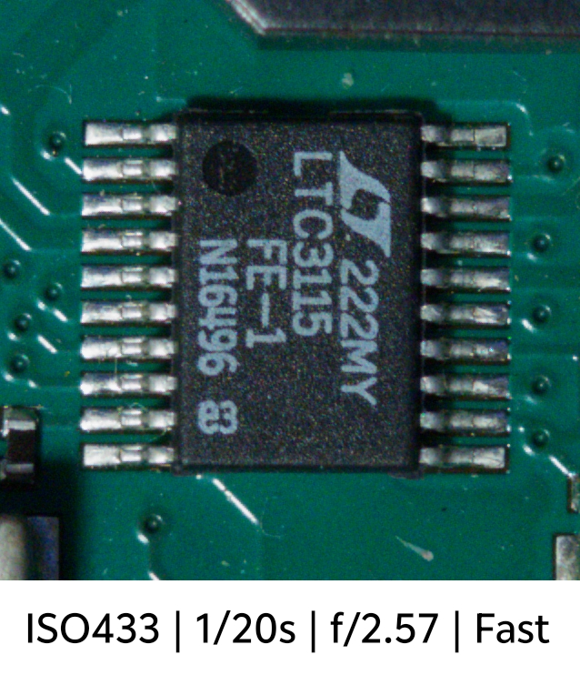 | 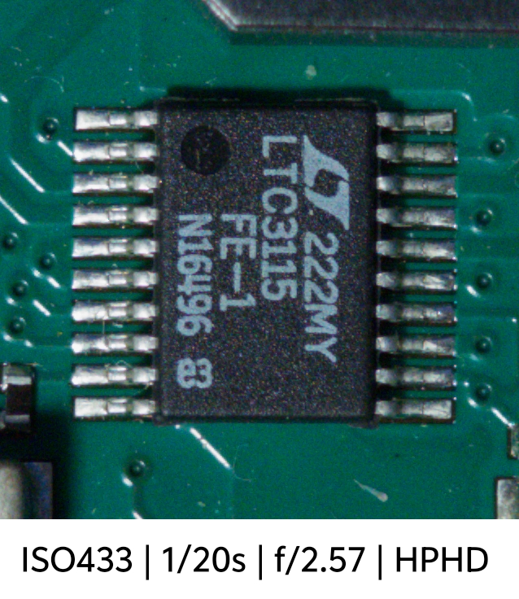 | 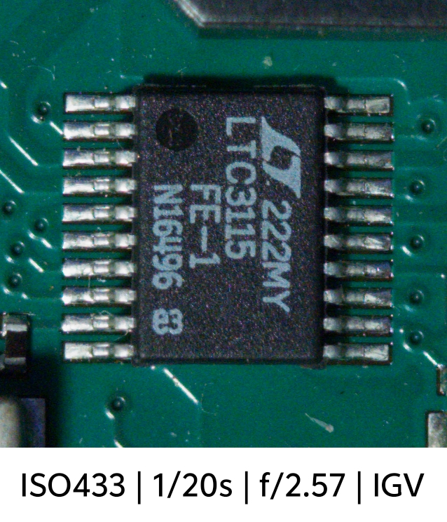 | 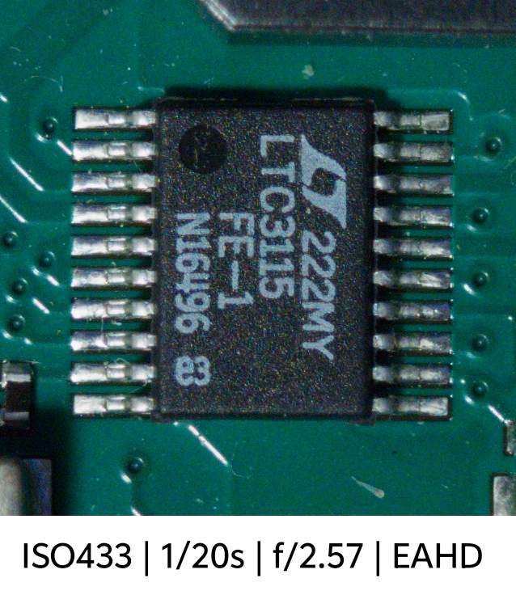 |
| **LMMSE** | **DCB** | **RCD** | **AMaZE** |
| 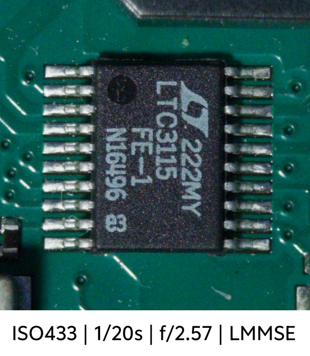 | 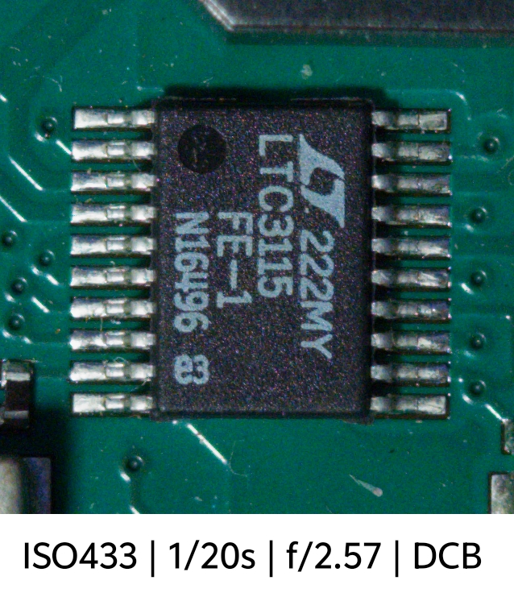 | 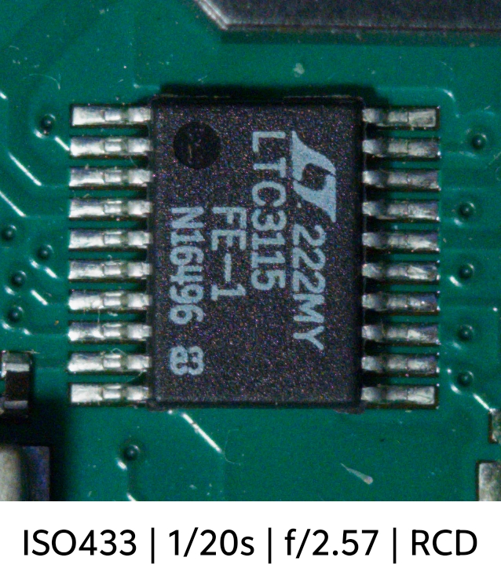 | 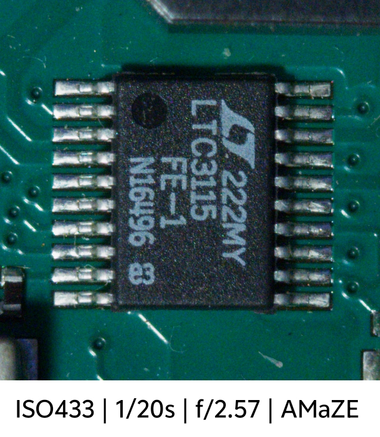 |

#### 实验性简单处理模式 (Experimental Simple Modes)
| 模式名称 | 逻辑 | 处理逻辑与适用场景 |
| :--- | :---: | :--- |
| **RGB通道** | `RGB Separation` | 四通道分屏预览（RGB/R/G/B），用于观察通道差异与算法调试。 |
| **原始拜尔** | `Raw Bayer` | 原始 Bayer 数据直读，保留单色网格状数据，用于导出未插值的物理形态。 |
| **灰度 (Mono)**| `Grayscale` | 2x2 邻域亮度平均。直接输出标准黑白影像，抛开色彩干扰，提高锐度。 |
| **亮度 (Luma)**| `Luminance` | 提取绿色通道代表亮度（2x2 求和），实现 **4倍感光度提升**。 |
| **4合1 (Bin4)** | `2x2 Binning` | 2x2 同通道平均。降噪提升锐度，牺牲分辨率换取常规环境纯净度。 |
| **9合1 (Bin9)** | `3x3 Binning` | 3x3 同通道平均。牺牲分辨率换取较高环境纯净度。 |
| **16合1 (Bin16)**| `4x4 Binning` | 4x4 同通道平均。牺牲分辨率换取极高环境纯净度。 |
| **4倍亮度** | `Bin4 Sum` | 4x4 同通道求和。**极大幅度感光提升**，用于极限纯黑环境识别。 |

#### 效果预览 (Simple Modes Preview)
| RGB通道 | 原始拜尔 | 灰度 | 亮度 |
| :---: | :---: | :---: | :---: |
| 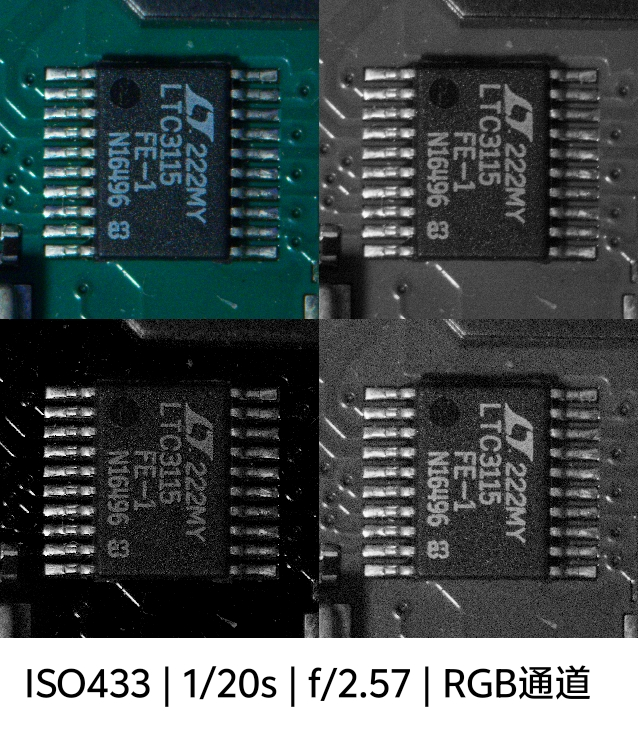 | 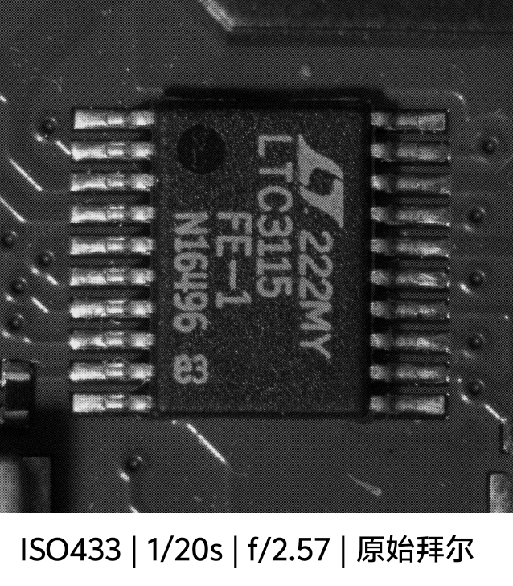 | 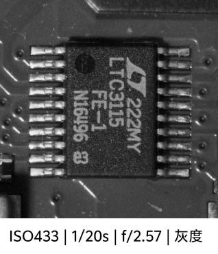 | 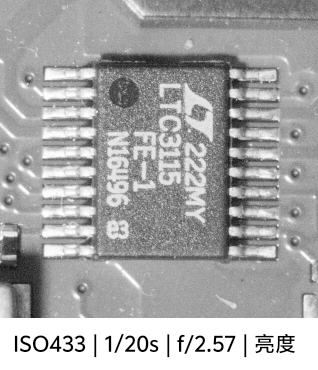 |
| **4合1** | **9合1** | **16合1** | **4倍亮度** |
| 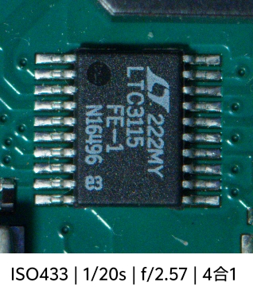 | 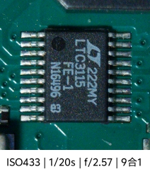 | 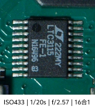 | 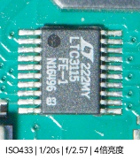 |

### Phase 4: 色彩空间与后期处理 (Color & Post-processing)
*   **高光恢复 (Highlight Recovery)**：应用自适应渠道窃取算法，通过邻域纹理转移，修复单一通道提前饱和导致的过曝偏紫现象。
*   **色彩校正 (CCM)**：提取设备内置 3x3 颜色校正矩阵，将传感器色彩空间映射至标准 **sRGB** 或宽色域 **Display P3**。
*   **色调映射 (Tonemapping)**：应用 ACES-like 拟合曲线与线性 soft-clip，动态压缩防止高光硬剪裁。
*   *(规划中) 噪点抑制 (NR) & 锐化 (USM)*：为保留最真实的光学原始状态，目前未施加额外的空域/频域降噪及 USM 锐化。

### Phase 5: 结果固化与元数据注入 (Finalization & Storage)
*   **多格式并行编码**：将浮点 RGB 编码为标准 JPEG 或高压缩率 8-bit HEIF。
*   **EXIF 深度注入**：读取 `SENSOR_INFO_PHYSICAL_SIZE` 结合焦距计算等效 35mm 视角。通过在内存构建虚拟 1x1 JPG 提取 `0xFFE1` (APP1) 段，将实时换算的 `ShutterSpeedValue` 与 `ApertureValue` 精确注入最终成片。
*   **文件存储**：自动生成 `yyyyMMdd_HHmmss_SSS.[ext]` 毫秒级时间戳，防连拍重名，安全存入 `/DCIM/wCam/` 目录。支持 RAW (DNG)、JPG、HEIC 格式输出。

---

## ⚙️ 动态设备配置驱动 (JSON Configuration)
### 目前仅适配 vivo x300 和 Redmi Note 12 Turbo 俩款机型。
为了解决安卓设备底层 Camera API 接口碎片的难题，wCam 使用了 `configs.json` 驱动机制。  
应用启动时会自动检测设备型号。直接读取配置策略文件，实现免代码修改适配：
*   识别设备真实的物理镜头数量及调用逻辑。
*   自动筛选支持 RAW 格式输出的硬件接口。
*   修正厂家非标准镜头排列，正确映射“主摄”、“超广角”等 UI 标签。

---

## 📂 项目结构

```text
wCam/
├── app/
│   ├── src/main/cpp/             # NDK 核心算法层 (C++)
│   │   ├── demosaic/             # 顶级去马赛克算法库 (AMaZE, RCD, DCB, etc.)
│   │   ├── native-lib.cpp        # JNI 接口、Bayer 预处理与图像分发逻辑
│   │   ├── histogram.cpp         # GPU 加速实时直方图统计算法
│   │   └── CMakeLists.txt        # NDK 编译配置
│   ├── src/main/java/com/example/wcam
│   │   ├── camera/               # 相机底层核心逻辑 (Camera2 API)
│   │   │   ├── CameraCoordinator.kt # 相机生命周期与流程调度
│   │   │   ├── CaptureManager.kt    # 拍摄分发、预闪状态机、快门锁
│   │   │   ├── CaptureProcessor.kt  # 显影流程驱动与多格式编码
│   │   │   ├── DemosaicEngine.kt    # NDK 引擎接口与位图生成
│   │   │   ├── PhotoParamMapper.kt  # 物理参数（ISO/快门/WB）推算逻辑
│   │   │   └── RawMediaStore.kt     # RAW 存储与 EXIF APP1 元数据管理
│   │   ├── ui/                   # 自定义交互控件与界面
│   │   ├── viewmodel/            # 业务数据流 (Jetpack ViewModel)
│   │   ├── util/                 # 工具类 (日志、权限管理)
│   │   ├── MainActivity.kt       # 应用入口
│   │   └── PreferenceManager.kt  # 设置及 JSON 配置存储管理
│   └── build.gradle.kts          # App 级构建配置
├── build.gradle.kts              # 项目级构建配置
└── README.md                     # 项目说明文档
```

---

## ⚠️ 已知限制与风险

1.  **内存占用较高**：12MP 的 16-bit 显影缓冲区将占用约 48MB 内存，极限高频连拍下可能会导致内存溢出 (OOM)。
2.  **纯 CPU 处理延迟**：去马赛克算法全依赖 CPU 浮点运算。在运行顶级复杂算法（如 AMaZE）处理 1200 万像素图像时，约需耗时 1~2 秒。
3.  **部分机型色彩兼容**：未完全适配的机型如无法正确解析硬件 `WhiteLevel` 阈值，可能会在强光下出现全绿或全紫色调的渲染异常。

---

## 🛠 编译与开发指南

本项目由 **gemini-3-flash-preview** (AI Agent) 驱动开发构建。
*   **开发环境**: Android Studio (2026.1.1+)
*   **C++ 工具链**: NDK 28.2.13676358
*   **构建系统**: Gradle 8.0+ (Kotlin DSL)
*   **环境依赖**: 请务必在项目的 `local.properties` 文件中正确配置 `sdk.dir` 与 `ndk.dir` 绝对路径。

> **⚖️ 免责声明**：本项目仅供学术交流、数字信号处理研究与移动端 ISP 开发参考，不提供任何技术承诺与商业化支持。
