# CameraCoordinator 流程图

## 功能描述
`CameraCoordinator` 是 wCam 相机系统的 "逻辑大脑"。它的核心职责是解耦 Activity 与复杂的 Camera2 API，具体包括：
1. **后台线程管理**：维护 `HandlerThread` 处理所有相机操作，避免阻塞主线程。
2. **状态维护**：保存当前活跃的 `CameraDevice`、`CameraCaptureSession` 以及相机特性（`CameraCharacteristics`）。
3. **流程控制**：编排从 "打开相机" 到 "创建会话" 再到 "开启预览" 的完整流水线。
4. **拍摄调度**：处理手动拍摄、倒计时拍摄、间隔拍摄和连拍逻辑。
5. **硬件控制转发**：将 UI 层的变焦、对焦、闪光灯指令下发给硬件层。

## 核心处理流程

```mermaid
graph TD
    A[start] --> B[创建后台线程 & Handler]
    B --> C[初始化 CaptureManager & AutoCaptureManager]
    
    subgraph 开启相机流
        D[openCamera] --> E[CameraManager.openCamera]
        E --> F[onCameraOpened]
        F --> G[配置 ImageReader]
        G --> H[createPreviewSession]
    end

    subgraph 会话创建
        H --> H1[计算预览尺寸]
        H1 --> H2[获取 SurfaceTexture]
        H2 --> H3[创建 CaptureRequest.Builder]
        H3 --> H4[应用手动参数 & 变焦]
        H4 --> H5[CaptureSessionManager.createSession]
        H5 --> H6[onSessionConfigured]
    end

    subgraph 拍摄流
        I[capturePhoto] --> J{检查倒计时?}
        J -- 是 --> K[CountdownManager]
        J -- 否 --> L[executeCaptureAction]
        K --> L
        L --> M{闪光灯 SINGLE?}
        M -- 是 --> N[开启手电筒模式脉冲]
        M -- 否 --> O[CaptureManager.capturePhoto]
        N --> O
        O --> P[onCaptureCompleted]
    end
```

## 关键方法说明
- `createPreviewSession()`: 核心方法，负责将预览 Surface 和 RAW 读取器 Surface 绑定到相机流。
- `executeCaptureAction()`: 触发实际的拍照指令。如果处于手动闪光灯模式，会先开启 LED 再下发捕捉请求。
- `resumePreview()`: 重新下发 `setRepeatingRequest` 指令，使预览画面恢复流动。
- `applyZoomToRequest()`: 针对 Android 11+ 使用 `CONTROL_ZOOM_RATIO`，旧版本则手动计算 `SCALER_CROP_REGION` 实现数码变焦。
- `onHardwareExposureStarted()`: 这是一个关键回调，用于在长曝光开始时精确控制闪光灯的关闭时间。
