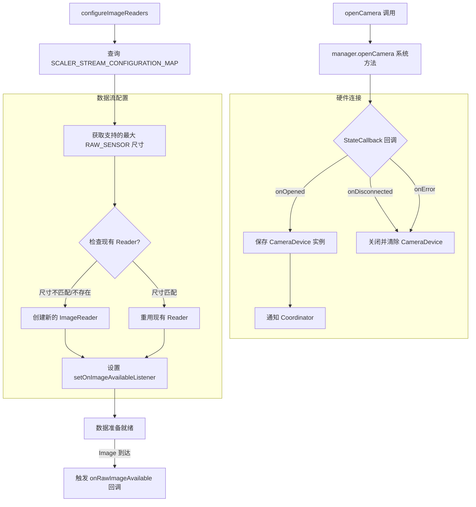

# CameraManager 流程图

## 功能描述
`CameraManager` 是应用中与 Android 系统相机服务（`android.hardware.camera2.CameraManager`）直接打交道的底层封装类。它的职责非常专一：
1. **硬件连接管理**：调用系统 API 打开物理/逻辑摄像头。
2. **状态监测**：通过 `StateCallback` 捕获相机的开启、断开连接及硬件错误事件。
3. **数据出口配置**：根据相机特性查询支持的分辨率，并配置 `ImageReader`。
4. **RAW 数据捕获**：它是 RAW_SENSOR 数据流进入应用的第一个关口，负责接收并分发 Image 对象。

## 核心处理流程

## 关键方法说明
- `openCamera()`: 这是一个异步操作。它接收一个 `backgroundHandler`，确保相机打开的繁重工作在后台线程进行，不会引起界面卡顿（ANR）。
- `configureImageReaders()`: 非常关键的一步。它决定了拍照的最高画质。如果设备支持 `RAW_SENSOR` 格式，它会选取最大的输出尺寸，确保 DNG 文件的完整分辨率。
- `rawImageReader`: 采用 `RAW_SENSOR` 格式和容量为 8 的缓冲区。这意味着应用可以在短时间内连续缓存 8 帧 RAW 图片，为实现超快连拍提供了可能。
- `releaseReaders()`: 释放内存的关键。如果不手动关闭 `ImageReader`，会导致 Native 层内存泄露，最终引起应用崩溃。
