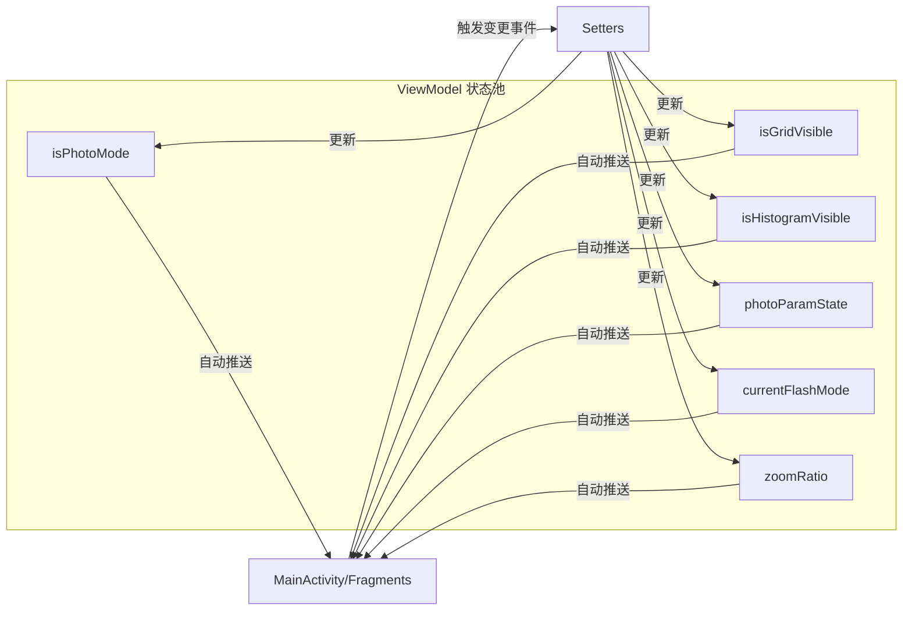

# CameraViewModel 流程图

## 功能描述
`CameraViewModel` 遵循 Android 推荐的架构模式，作为 UI 与业务逻辑之间的 "数据缓存层"。它的核心职责包括：
1. **状态持久化**：在 Activity 因系统原因重建（如屏幕旋转）时，保护当前的拍摄状态不丢失。
2. **响应式驱动**：利用 `StateFlow` 实现数据驱动 UI。当 ViewModel 中的数据发生变化时，UI 会自动收到通知并更新。
3. **单向数据流**：提供显式的 `set` 方法用于修改状态，确保状态变更的来源可追踪。
4. **解耦**：将 UI 的显示状态（如面板是否开启、开关是否打开）与具体的 Activity 逻辑分离。

## 核心状态模型

## 关键变量说明
- `photoParamState`: 一个复杂的对象，包含 EV、WB、ISO、Shutter 和 AF 的状态（包括自动/手动标志和当前值）。它是手动相机功能的核心数据源。
- `MutableStateFlow` vs `StateFlow`: 使用私有的 `MutableStateFlow` 保证只有 ViewModel 内部能修改数据，暴露只读的 `StateFlow` 给外部订阅。
- `isPhotoMode`: 控制相机系统是在照片模式还是视频模式下运行，会影响预览的分辨率选择策略。
- `zoomRatio`: 记录当前的变焦倍率。虽然变焦动作由手势触发，但倍率状态保存在这里以保证 UI 上的变焦文本显示正确。
- `currentFlashMode`: 管理闪光灯的三种状态：关闭、单次拍摄触发、持续常亮（手电筒模式）。
