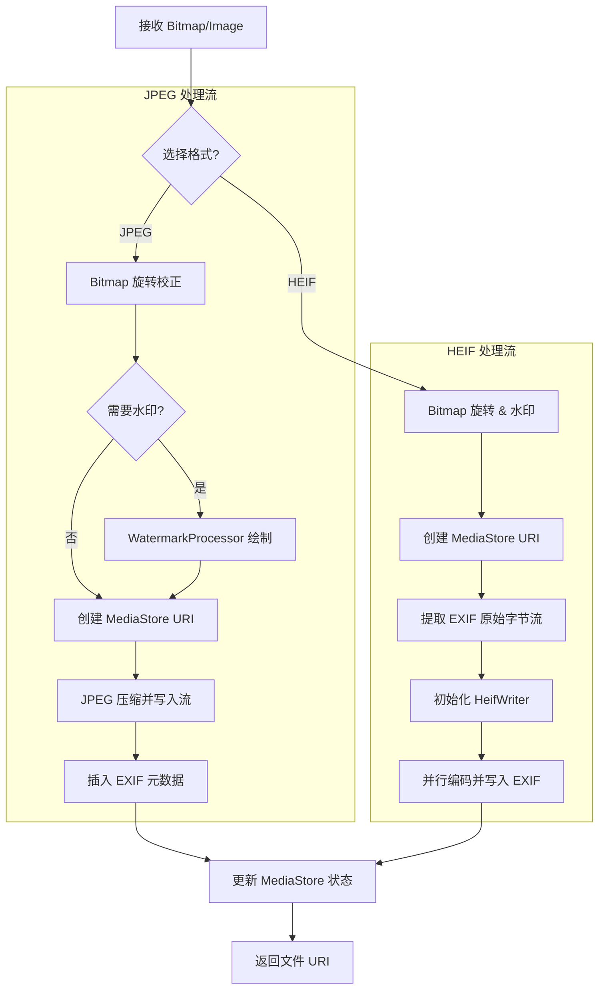

# CaptureProcessor 流程图

## 功能描述
`CaptureProcessor` 是 wCam 的 "照片加工厂"。它的主要职责是接收原始像素数据并将其转换为用户可见的文件。功能包括：
1. **多格式支持**：支持 JPEG 和 HEIF (High Efficiency Image File) 格式的编码。
2. **后期处理**：执行图像旋转（根据拍摄时设备方向）和水印合成（`WatermarkProcessor`）。
3. **EXIF 写入**：将相机的曝光参数（ISO、快门、焦距、光圈、曝光补偿等）精确写入照片文件头。
4. **MediaStore 集成**：通过 `ContentResolver` 与 Android 系统相册对接，支持 Android 10+ 的分区存储（Scoped Storage）。
5. **位置信息管理**：根据用户设置将 GPS 坐标嵌入照片。

## 核心处理流程

## 关键方法说明
- `saveJpegBitmap()`: 传统的 JPEG 保存流程。使用 `ExifInterface` 在文件保存后通过文件描述符修改元数据。
- `saveHeifBitmap()`: 使用 `androidx.heifwriter` 实现高效编码。与 JPEG 不同，HEIF 需要先构造 EXIF 字节数组再通过 Writer 注入。
- `writeExifMetadata()`: 映射 Camera2 结果到标准 EXIF 标签。例如，将纳秒级的 `SENSOR_EXPOSURE_TIME` 转换为秒单位。
- `extractExifBytes()`: 这是一个精巧的工具方法，通过创建一个 1x1 的临时 JPEG 文件来利用 `ExifInterface` 生成符合标准的 EXIF 字节块，用于 HEIF 写入。
- `createPhotoDisplayName()`: 生成符合 `yyyyMMdd_HHmmss_SSS` 格式的文件名，确保文件名唯一且有序。
