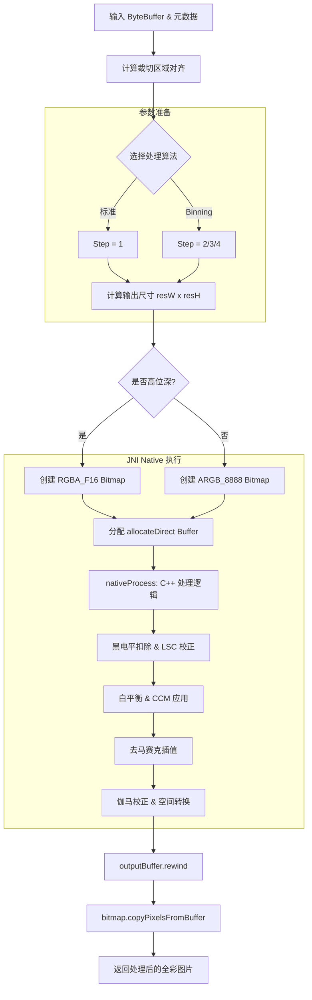

# DemosaicEngine 流程图

## 功能描述
`DemosaicEngine` 是 wCam 的 "像素处理核心"。由于 RAW 数据每个像素点只包含 R、G 或 B 中的一种颜色（马赛克排列），该引擎通过复杂的数学算法恢复丢失的颜色信息。其核心功能包括：
1. **去马赛克 (Demosaicing)**：将单色 Bayer 数据插值为全彩色 RGB。
2. **像素合并 (Binning)**：支持 Bin4/Bin9/Bin16 等算法，通过牺牲分辨率换取更高的信噪比和亮度。
3. **ISP 基本处理**：在 Native 层集成白平衡 (WB)、颜色校正 (CCM) 和黑电平补偿。
4. **镜头阴影校正 (LSC)**：利用相机提供的 `shadingMap` 修正由于镜头光学特性导致的图像四周变暗问题。
5. **高性能计算**：通过 JNI 调用 C++/SIMD 代码，直接操作 `DirectBuffer` 以获得最高处理性能。

## 核心处理流程

## 关键方法说明
- `nativeProcess()`: JNI 外部方法。它处理的是 `DirectByteBuffer`，这允许 Java 和 C++ 共享同一块内存，避免了昂贵的数组拷贝开销。
- `Bin4/Bin9/Bin16`: 这些算法在低光环境下非常有效，通过对相邻像素取平均，极大地降低了噪点。
- `RGBA_F16`: 16 位半精度浮点格式，能够保留超过 8 位（255 级）的亮度动态范围，是实现高质量 HDR 的基础。
- `cropRect 对齐`: 核心逻辑之一。Bayer 格式要求裁切必须是 2 的倍数（RG/GB 对），否则会导致颜色通道错位。
- `shadingMap`: 这是一个网格增益图，Native 层通过双线性插值将其应用到每一个原始像素上，消除暗角。
