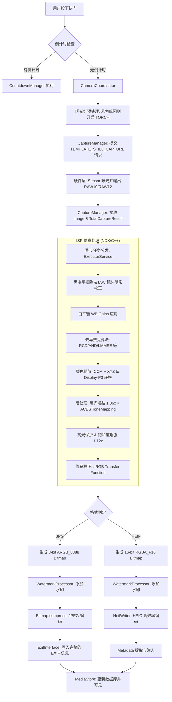

# wCam 图像捕获与保存流程分析 (JPG & HEIF)

## 1. 业务流程总览

从用户按下快门到最终文件保存到相册，整个过程经历了硬件控制、原始数据解析、ISP 仿真计算、后处理增强以及多格式编码五个核心阶段。

### 流程图 (Mermaid 风格)

---

## 2. 核心参数与处理细节

### A. 伽马校正 (Gamma Correction)
- **处理方式**: 采用了标准的 sRGB 传递函数。
- **8-bit 路径**: 为了性能，使用了预计算的 `gamma_lut` 查找表（1024 级）。
- **16-bit 路径**: 直接使用公式计算 `to_srgb_f`，确保在 HEIF 编码前将线性数据转换到感知空间，防止暗部出现断层。
- **公式**: 
  - 当 $v \leq 0.0031308$ 时，$f(v) = 12.92v$
  - 否则，$f(v) = 1.055v^{(1/2.4)} - 0.055$

### B. 曲线校准与色调映射 (Curve & Tonemapping)
- **Tone Mapping**: 采用了类似 ACES 的拟合曲线，公式如下：
  $$res = \frac{x(2.51x + 0.03)}{x(2.43x + 0.59) + 0.14}$$
  该曲线能有效压缩高光，同时保持阴影对比度，使画面具有“电影感”。
- **高光保护**: 当像素亮度峰值超过 0.88 时，算法会启动高光去饱和逻辑，将过曝区域平滑地推向纯白，避免彩色溢出。

### C. 镜头阴影校正 (LSC)
- **动态调整**: 根据 ISO 自动调整校正强度。高 ISO 下会自动减弱 LSC（通常减为 50%），以防止边缘出现过大的彩色噪声。
- **校正模型**: 优先使用硬件返回的 `SHADING_MAP` 网格数据进行双线性插值校正；若不可用，则回退到多项式径向校正模型。

### D. 颜色管理
- **CCM (Color Correction Matrix)**: 结合了传感器原始矩阵和 Bradford 色度适配算法。
- **色彩空间**: 输出强制锁定在 **Display P3** 广色域，在支持的设备上能显示更鲜艳的红色和绿色。

---

## 3. JPG 与 HEIF 的关键区别

| 特性 | JPG 处理流程 | HEIF 处理流程 |
| :--- | :--- | :--- |
| **位深** | 8-bit (ARGB_8888) | **16-bit (RGBA_F16)** |
| **编码器** | 系统自带 JPEG 压缩 | **androidx.heifwriter** (硬件加速) |
| **画质倾向** | 兼容性优先，有轻微块状伪影 | 动态范围优先，渐变平滑，无伪影 |
| **元数据处理** | 直接使用 `ExifInterface` 写入文件头 | 需先生成虚拟 JPG 提取 EXIF 字节流再注入 |
| **存储效率** | 文件较大 | **文件体积缩小约 50%** |

---

## 4. 总结
本项目的图像保存流程高度模拟了现代智能手机的 ISP 逻辑，不仅完成了基础的格式转换，还加入了**高光保护、广色域管理和电影感色调映射**等高级特性。HEIF 路径由于采用了 16-bit 浮点 Bitmap 作为输入，其在保留细节和动态范围方面具有显著优势。
