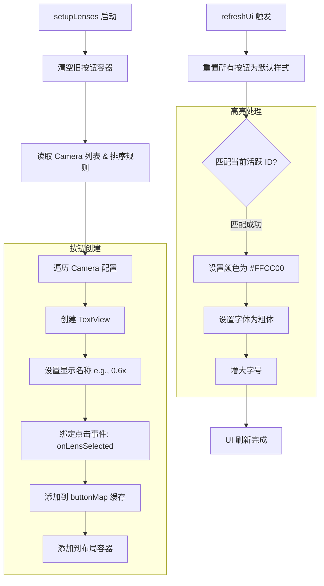

# LensController 流程图

## 功能描述
`LensController` 是 wCam 的 "多镜头导航仪"。它使得应用能够适配各种硬件配置（双摄、三摄甚至五摄），其核心职责包括：
1. **动态 UI 生成**：不硬编码镜头，而是根据 `config.json` 动态向布局中添加按钮。
2. **镜头映射**：将用户可见的标签（如 "UW", "Main", "Tele"）映射到系统的逻辑 CameraID 或物理 CameraID。
3. **视觉反馈**：通过文字颜色、大小和字体的变化，直观地提示用户当前正在使用哪个镜头。
4. **排序管理**：支持通过配置列表调整镜头按钮的显示顺序，以符合用户习惯。

## 核心处理流程

## 关键方法说明
- `setupLenses()`: 仅在应用初始化或配置变更时调用。它使用 `LinearLayout.LayoutParams` 并设置权重为 1，使得镜头按钮能均匀分布在底部栏。
- `refreshUi()`: 每当发生镜头切换或应用恢复时调用。它通过 `buttonMap` 快速定位对应的视图，避免频繁的 `findViewById`。
- `buttonMap 键值策略`: 对于后置镜头，直接使用物理 ID 作为键；对于前置，由于可能共享逻辑 ID，采用了 `FRONT_` 前缀进行区分。
- `LensListener`: 这是一个接口回调，当用户点击某个镜头按钮时，它会通知 `MainActivity` 进而触发 `CameraCoordinator` 重新开启相应的摄像头硬件。
