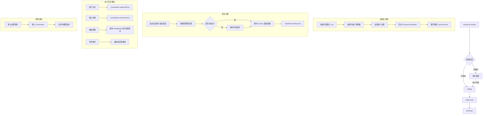

# MainActivity 流程图

## 功能描述
`MainActivity` 是 wCam 应用的核心 Activity，担任 "中央枢纽" 的角色。它负责：
1. **生命周期管理**：协调相机硬件的开启与关闭，确保在应用前后台切换时正确释放资源。
2. **UI 协调**：初始化并管理多个 UI 控制器（如 `CameraUiController`, `ManualParamController`, `LensController` 等）。
3. **权限处理**：确保相机、存储和位置权限已授予。
4. **交互路由**：将用户的手势、点击事件转发给相应的业务逻辑层（如 `CameraCoordinator`）。
5. **状态同步**：观察 `CameraViewModel` 的状态变化，并实时更新 UI 元素。

## 核心处理流程

## 关键方法说明
- `initApp()`: 执行应用启动的关键路径初始化，包括 `ConfigManager` 和硬件预热。
- `handleOnResume()`: 处理热启动逻辑，确保在返回应用时相机能快速恢复预览。
- `observeViewModel()`: 使用协程流（Flow）实时监听曝光、对焦等参数的变化并更新 UI。
- `rotateUiElements()`: 根据设备重力传感器方向，通过动画旋转所有按钮图标，保持界面方向正确。
- `onSingleTap()`: 处理预览区的单点对焦，显示对焦环并通知底层执行 AF。
