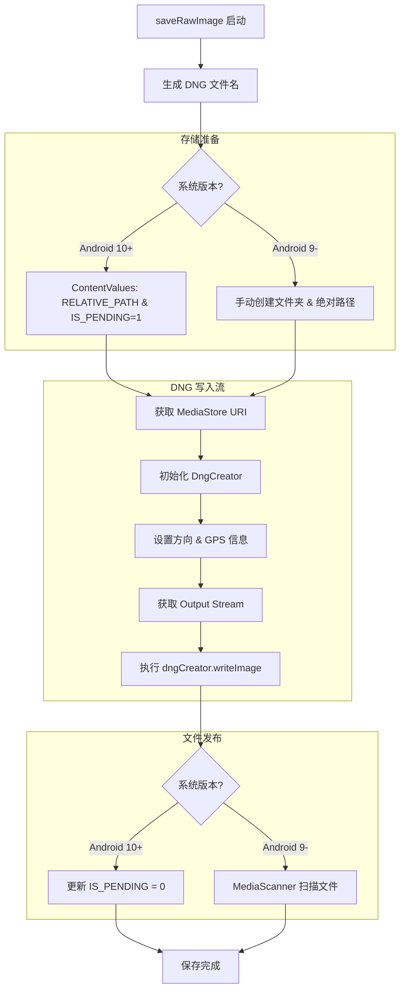

# RawMediaStore 流程图

## 功能描述
`RawMediaStore` 是专门为 RAW 格式设计的存储层。它的核心任务是将相机传感器输出的 "数字负片" (RAW Data) 转化为通用的 DNG 文件。主要功能包括：
1. **DNG 合成**：使用 `DngCreator` 将原始像素数据、镜头校正参数、白平衡元数据等封装在一起。
2. **MediaStore 事务管理**：处理 RAW 文件的创建、锁定和发布流程。
3. **最新照片检索**：快速查找应用保存的最新的照片 URI，供相册按钮预览使用。
4. **兼容性适配**：处理传统文件路径 (Android 9 及以下) 与分区存储 (Android 10+) 的差异。

## 核心处理流程

## 关键方法说明
- `saveRawImage()`: 核心同步方法。它需要 `Image` (RAW_SENSOR) 和 `TotalCaptureResult`。注意，DNG 的保存对元数据依赖性极高，缺少 result 将无法生成有效的 DNG。
- `DngCreator`: Google 提供的官方工具，能够处理黑电平校正、颜色矩阵转换等极其复杂的 RAW 处理逻辑。
- `findLatestRecentPhotoUri()`: 使用 SQL 风格的查询，过滤 `RELATIVE_PATH` 或 `DATA` 字段中包含 "wCam" 的记录。
- `loadThumbnailBitmap()`: 利用 Android 10 的 `loadThumbnail` API 直接从 DNG 中提取嵌入的缩略图，而无需完整解码，极大提升性能。
