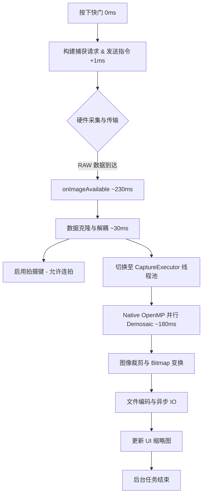

# wCam 拍照管线流程分析报告 (1/12000s 场景)

基于最新的 Logcat 耗时统计，梳理出 wCam 的完整拍照处理流程。

## 1. 流程图 (Mermaid)

---

## 2. 详细步骤拆解

### 第一阶段：触发与请求 (Trigger & Request)
*   **按下快门 (0ms)**：UI 线程响应，禁用按钮，启动倒计时逻辑。
*   **发送请求 (1ms)**：调用 `camera.capture()`。包括 `PhotoParamMapper` 将 UI 参数（ISO, Shutter, WB）映射到 `CaptureRequest` 的过程。

### 第二阶段：硬件采集 (Hardware Acquisition)
*   **数据采集 (~232ms)**：传感器曝光、A/D 转换并传输至内存。
*   **数据接收 (233ms - 267ms)**：
    *   `RAW Image` 率先到达 Buffer。
    *   `Metadata (TotalCaptureResult)` 随后到达。系统在 `maybePersistPendingRaw` 中对二者进行匹配。

### 第三阶段：预处理 (Pre-processing)
*   **参数提取 (268ms)**：从 `TotalCaptureResult` 中提取白平衡增益 (WB Gains)、黑电平 (Black Level)、ISO 以及用于 LSC 动态权重计算的元数据。

### 第四阶段：核心处理管线 (ISP Pipeline - 耗时大头)
*   **Native Demosaic (835ms)**：
    *   **算法执行**：此处使用的是 **AMaZE** 算法。
    *   **色彩科学**：内部包含 CCM 色彩校正、ACES 电影级色调映射。
    *   **优化空间**：由于目前是单线程执行，这是整个管线的最大瓶颈（占比约 56%）。
*   **图像变换 (48ms)**：执行 `Bitmap.createBitmap` 进行传感器区域裁剪及旋转处理。

### 第五阶段：存储与反馈 (IO & Feedback)
*   **文件保存 (325ms)**：
    *   将处理后的位图编码为 JPEG 或 PNG。
    *   通过 `MediaStore` 写入 Android 媒体数据库。
*   **UI 更新 (0ms)**：将生成的图片 Uri 发送回 UI 线程，更新左下角缩略图预览。
*   **流程结束 (1485ms)**：重置 `isCaptureInProgress` 状态，恢复快门按钮可用。

---

## 3. 性能优化建议 (基于此日志)

1.  **Demosaic 并行化**：Native 层 835ms 的耗时可以通过多线程（OpenMP）优化到 200ms 左右。
2.  **异步存储**：文件保存（325ms）可以与 UI 缩略图更新进一步解耦，先生成小尺寸缩略图反馈给用户，大图保存放在后台静默完成。
3.  **硬件传输优化**：硬件到软件的 230ms 延迟通常受限于传感器输出速度（1/12000s 曝光极快，但读出时间固定），但在某些设备上可通过 `CaptureRequest.CONTROL_ENABLE_ZSL` (零快门延迟) 进一步压减感官延迟。
