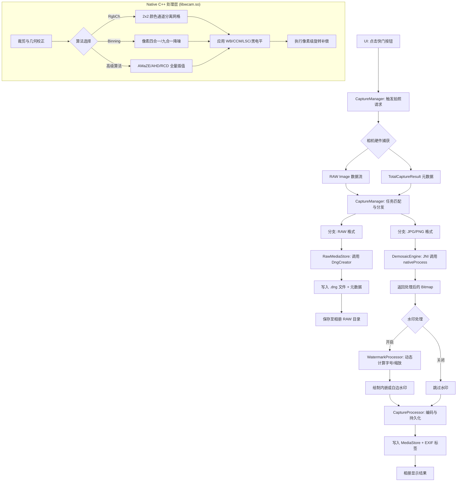

# wCam 拍摄与处理全流程深度分析

本文档详细描述了 wCam 项目在功能全开（同时保存 RAW/JPG/PNG、开启水印、使用复杂解拜耳算法）的情况下，从按下快门到文件保存至相册的完整技术路径。

---

## 1. 核心流程图 (Mermaid)

---

## 2. 阶段详细分解

### 2.1 触发阶段 (Trigger)
*   **入口**：`MainActivity` 监听到快门点击，通过 `CameraCoordinator` 调用 `CaptureManager.capturePhoto()`。
*   **参数锁定**：系统会立即锁定 AE (自动曝光) 和 AF (自动对焦)，并根据当前 UI 上的手动设置（ISO、快门、对焦距离）构建 `CaptureRequest`。

### 2.2 数据捕获 (Hardware Acquisition)
*   **双流并行**：
    1.  **Image 数据**：从 `ImageReader` 异步获取 `ImageFormat.RAW_SENSOR` 原始数据。
    2.  **元数据**：通过 `CaptureCallback` 获取 `TotalCaptureResult`，包含拍摄瞬间的实时增益、白平衡系数、镜头遮蔽图 (LSC) 和传感器时间戳。
*   **同步逻辑**：`CaptureManager` 使用 `timestamp` 作为唯一标识符，确保 RAW 数据与对应的拍摄参数完全匹配。

### 2.3 Native 核心处理 (NDK Processing)
这是 wCam 的技术核心，代码位于 `native-lib.cpp`：
*   **RgbCh 算法**：
    *   将 2x2 的 Bayer 像素块直接映射为：彩色混合、红通道(灰度)、绿通道(灰度)、蓝通道(灰度)。
    *   **旋转补偿**：针对手机传感器横向安装的特性，在 JNI 层执行坐标映射，确保四个通道在 2x2 宫格中的物理位置固定。
*   **Binning 算法**：通过像素合并（如 4x4 合并为 1 个像素）显著提升高 ISO 环境下的信噪比。
*   **高级 Demosaic**：
    *   `AMaZE` / `RCD` 等算法通过复杂的边缘检测，在抑制摩尔纹的同时最大程度恢复 RAW 细节。
    *   应用 **CCM (颜色校正矩阵)** 将传感器颜色空间转换为标准的 sRGB 空间。

### 2.4 后期增强 (Post-Processing)
*   **自适应水印**：
    *   `WatermarkProcessor` 根据配置从 `configs.json` 读取基础参数。
    *   **自动缩放**：如果照片宽度不足以放下水印，系统会自动计算缩放比例，等比缩小字号与间距。
    *   **外部白边**：根据动态计算的字号高度自动撑开白边。
*   **格式转换**：由 `CaptureProcessor` 执行最后的 Bitmap 编码（JPG 质量由用户设置决定）。

### 2.5 存储与相册同步 (Persistence)
*   **MediaStore API**：使用 Android 10+ 的沙盒模式写入 `Pictures/wCam` 文件夹。
*   **EXIF 写入**：
    *   JPG/PNG 文件会被注入详细的摄影信息：Make (厂商)、Model (机型)、Exposure (快门)、ISO、Focal Length (焦距)、GPS 坐标。
    *   `softwareName` 标签会被标记为 `wCam [Version]`。

---

## 3. 不同算法的处理逻辑差异表

| 算法类型 | 空间分辨率 | 处理延迟 | 旋转处理方式 | 主要用途 |
| :--- | :--- | :--- | :--- | :--- |
| **RAW (.dng)** | 100% (原始) | 极低 | 通过 Exif Tag 标记 | 后期专业修图 |
| **Fast/AHD** | 100% (插值) | 中 | JNI 整体旋转 | 日常高画质记录 |
| **Bin4/9/16** | 25% / 11% / 6% | 低 | JNI 整体旋转 | 极限暗光降噪 |
| **RgbCh** | 25% (2x2网格) | 低 | JNI 象限坐标重映射 | 传感器特性分析/科研 |

---

## 4. 异常处理机制
*   **内存管理**：在 Native 层处理完像素后，Java 层会立即调用 `image.close()` 和 `bitmap.recycle()` 以释放昂贵的内存资源。
*   **异步线程池**：所有图像处理任务均在 `captureExecutor` (单线程或多线程池) 中执行，不会阻塞 UI 预览和后续拍摄。
